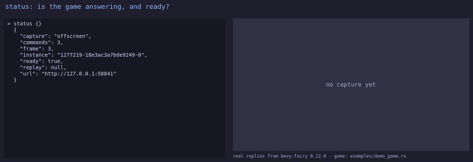
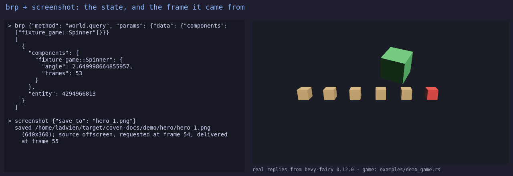

# bevy_fairy

> ⚠️ **Vibe Coded.** Written by AI agents working from a human's direction, covered by tests rather than a line-by-line human review. Read the code before you rely on it for something you care about.

Let a coding agent look inside a running Bevy game, drive it, and ask the person playing it for help — without touching your desktop.

[](https://crates.io/crates/bevy_fairy) [](https://docs.rs/bevy_fairy) [](https://github.com/bevy-coven/bevy_fairy/actions/workflows/ci.yml) [](https://bevyengine.org) [](#who-and-licence)



*The whole loop in six seconds: `status`, a `brp` read of the spinner beside the frame its `screenshot` call saved, then three `run` calls spawning cubes. Every reply is the server's own output and every picture is the game's own frame. The still below is that run's `brp` + `screenshot` pair; [the longer tour and a real agent session](docs/media/README.md) sit beside them.*



**Status:** usable · Bevy 0.20 · MSRV 1.95

**Why:** an agent debugging a game from its source code is guessing, and the obvious alternative — OS screenshots and OS keystrokes — needs the game's window raised and focused: on the game this was built for, a capture with the window focused had 7,188 distinct colours and with another app in front it had **one**, and a synthetic key goes to whichever window happens to have focus. So nothing here touches the operating system: captures come from the game's own pixels, input is written into Bevy's own input messages, and `tests/plugin_leaf.rs` fails the build if the plugin's dependency graph ever gains a crate that could synthesise an OS event.

## Quick start

`bevy_fairy` is one crate with two halves. A **game** links the plugin; an **agent** spawns the `bevy-fairy` server, which speaks [MCP](https://modelcontextprotocol.io) over stdio to the agent and the [Bevy Remote Protocol](https://docs.rs/bevy_remote) (BRP — Bevy's own JSON-RPC interface, usually on port 15702) to the game.

```sh
cargo add bevy_fairy --no-default-features --features plugin
```

```rust,no_run
use bevy::prelude::*;
use bevy::remote::http::RemoteHttpPlugin;
use bevy_fairy::DebuggerPlugin;

fn main() {
    App::new()
        .add_plugins(DefaultPlugins)
        // Owns the BRP RemotePlugin. Never add a second one next to it.
        .add_plugins(DebuggerPlugin::default())
        // Serves the bevy_fairy/* methods on 127.0.0.1:15702.
        .add_plugins(RemoteHttpPlugin::default())
        .run();
}
```

`DebuggerPlugin` adds Bevy's `RemotePlugin` itself, so adding one as well panics on start, and it needs `InputPlugin`, which `DefaultPlugins` has and `MinimalPlugins` does not.

```sh
cargo install bevy_fairy --no-default-features --features server
claude mcp add bevy-fairy -- bevy-fairy --stdio    # or the [clients page](docs/guide/clients.md)
curl -s localhost:15702 -d '{"jsonrpc":"2.0","id":1,"method":"bevy_fairy/status"}'
# {"jsonrpc":"2.0","id":1,"result":{...,"ready":true,...}}
```

```text
agent ──MCP over stdio──▶ bevy-fairy ──BRP over HTTP :15702──▶ your game + DebuggerPlugin
                                                                        │
                                                    card on screen ▼    │
                                                          the person at the keyboard
```

## Try it

```sh
cargo run --features plugin-screenshot --example demo_game
```

That is the game the tour was recorded from: six crates, a score, a mover, and a spinner with a bug planted in it. Point your agent at it and ask *"Call `status`, then list the game's resources with `brp`."* Then ask it to find which of the spinner's values stops changing, and on what frame.

## What you can do

- **Read state, and change it and undo it.** `brp` calls any BRP method the game serves; `observe` answers a short phrase query with the entities and their component values, and `diff: true` compares a read with the last one; `experiment` spawns, modifies and deletes entities and steps back through its own history — [tools](docs/guide/tools.md).
- **Watch a value over time.** `watch` samples a method repeatedly and says which fields moved and which stopped, each sample stamped with the game frame; `burst` returns a sequence of frames as one contact sheet; `bevy_fairy/ring` records N frames inside the game and freezes on a trigger — [tools](docs/guide/tools.md).
- **Run the game's own commands, and replay them.** `commands` lists what the game registered, with typed params and a worked example; `run` calls one; `scene save` writes the recorded run to a file that `BEVY_FAIRY_SCENE` replays at startup — [commands](docs/guide/commands.md), [scenes](docs/guide/scene.md).
- **See the screen.** `screenshot` captures a PNG from an offscreen render target or from the window, with a crop and a zoom, and returns the frame numbers it was asked and delivered on — [capture](docs/guide/capture.md).
- **Press keys, type, click and drag.** `bevy_fairy/input` writes keyboard, text, mouse, scroll and cursor input into the messages Bevy reads, so `ButtonInput`, text fields and `bevy_ui` picking all see it — [input](docs/guide/input.md).
- **Ask a person.** `guide` posts a script the game draws one step at a time, and the step moves on when a checkpoint your game registered passes — [guide](docs/guide/guide.md).
- **Test a claim, or look for an anomaly.** `hypothesis` runs a claim against the running game over many iterations and puts the game back after each; `detect_anomaly` scores velocities and state inconsistencies against thresholds you set — [claims](docs/guide/claims.md).

It cannot see frame time, CPU or memory: BRP does not report them, and the tools say so rather than make up a number.

## Part of the Coven

`bevy_fairy` is one of the [crates of the Bevy Coven](https://github.com/bevy-coven): the editor, [Grimoire](https://github.com/bevy-coven/bevy_grimoire), links this plugin behind its `debugger` feature, so an agent can look at the editor itself the same way it looks at a game. [How to use it in Grimoire](https://bevy-coven.github.io/crates/bevy_fairy.html#use-it-in-grimoire) is on the crate's page in [the book](https://bevy-coven.github.io/).

## Bevy compatibility

| bevy_fairy | Bevy |
|---|---|
| `0.2.0` and later (now `0.12.0`) | 0.20 |
| `0.1.10` | 0.19, then 0.16 before that |

## Learn more

- **[The tools](docs/guide/tools.md)**: every tool and argument, and what it refuses.
- **[`docs/mcp-tools.md`](docs/mcp-tools.md)**: the same list generated from the server's own `tools/list`, so it cannot drift.
- **[The guide](docs/guide/README.md)**: installing it into a game, the clients, input, capture, the guide overlay, claims and workflows.
- **[The book page](https://bevy-coven.github.io/crates/bevy_fairy.html)**, and the [API on docs.rs](https://docs.rs/bevy_fairy).
- **[Examples](examples/)**: each prints what happened, and most need no window or GPU.
- **[`evals/`](evals/README.md)** measures whether an agent with only this server can answer debugging questions about the fixture game.
- **[`CHANGELOG.md`](CHANGELOG.md)**, and [`CLAUDE.md`](CLAUDE.md) for the design decisions that are easy to undo by accident.

## Who and licence

Maintained by [@Ladvien](https://github.com/Ladvien). Issues and pull requests are welcome at [github.com/bevy-coven/bevy_fairy/issues](https://github.com/bevy-coven/bevy_fairy/issues); read the org's [CONTRIBUTING.md](https://github.com/bevy-coven/.github/blob/main/CONTRIBUTING.md) first.

Licensed under either of [MIT](LICENSE-MIT) or [Apache-2.0](LICENSE-APACHE), at your option.
